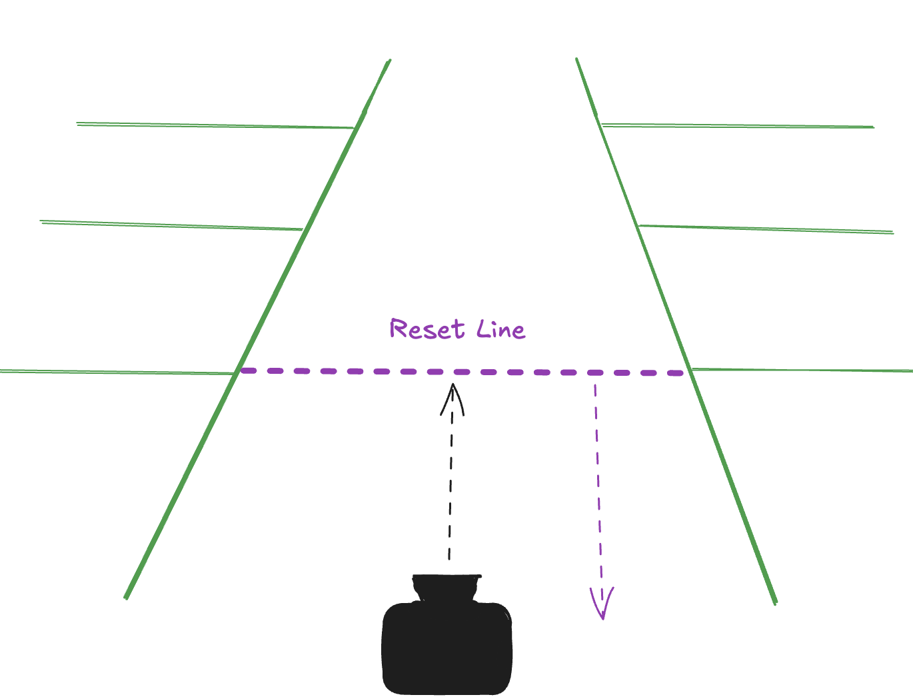
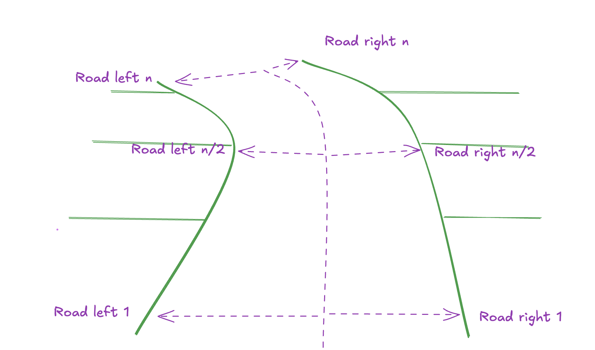
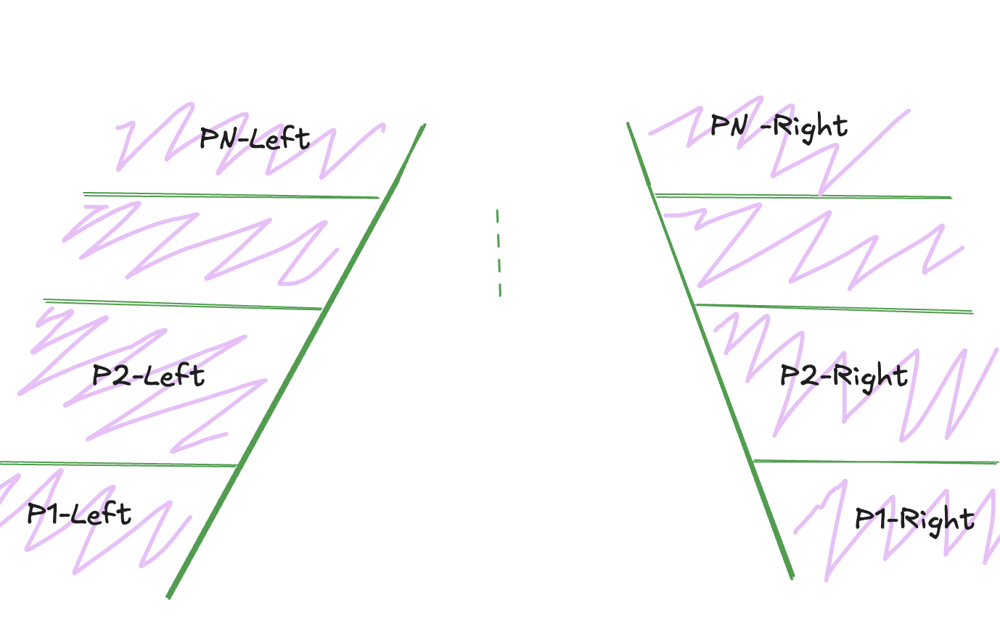

> "Not hearing is not as good as hearing, hearing is not as good as seeing, seeing is not as good as knowing, knowing is not as good as acting; true learning continues until it is put into action."
> - Xunzi

Personally, action is writing. My only goal here is to learn. I want it to be known that while this may provide a fresh perspective, the work is derivative. If you prefer to learn without derivation, I recommend reading [Lou's Pseudo 3D Page](https://www.extentofthejam.com/pseudo/index.html), then [How to build a racing game](https://jakesgordon.com/writing/javascript-racer/). I am 14 years behind a fad which was 30 years behind the origin of a technique.

## Setting The Foundation

Recently, I have been trying to understand 3D projection in a 2D space. This idea has been around for quite some time and has been used in many games over the years. Most modern games use engines, frameworks, or libraries that hide the intricacies behind the solution. I wanted to peek behind the curtain.

The common techniques I have seen are perspective projection, rasterization, and ray tracing. This blog is focused on perspective projection and rasterization. Over time, we will build increasing layers of complexity on a projected road. Throughout this blog, I provide interactive demos that can run by pressing the play button. Now that we've got that out of the way, let's dive in.

## Scan-line Rendering

The simplest road is two straight lines that vanish at the horizon. The road has some distance with a focal center point. Rendering the road becomes drawing the edges one scan line at a time. This becomes computing the left and right x values for each line of y.

This creates a problem: how do we get the correct x value for each y? We need to know how to render a three-dimensional point on a two-dimensional plane.

Moving objects farther away from the screen by changing their y position creates this effect. Using the law of similar triangles, we can determine how much to move an object along the y-axis. To do this, we need to introduce a camera and use the following equation.

```javascript
const y = horizon + (projectedScale * cameraHeight) / z;
```

However, we need to solve for z since we are walking one y value at a time. Applying some basic algebra, we can get this updated equation.

```javascript
const z = (projectionScale * cameraHeight) / (y - horizon)
```

Now, to put this all together, we can create a simple animation loop. In this loop, we iterate values of y from the bottom of the screen to the horizon. On each line, we project our left and right points using a `projectionScale`, relative position of `y`, fixed `cameraHeight`, and fixed `cameraZ`.

```javascript
addEventListener('load', () => {
    let canvas = document.getElementById('canvas');
    let context = canvas.getContext('2d');

    const canvasWidth = canvas.width = window.innerWidth;
    const canvasHeight = canvas.height = window.innerHeight;
    const canvasMiddle = roadMiddle = maxRoadWidth = canvasWidth / 2;
    const horizon = canvasHeight / 2;
    const projectionScale = canvasHeight - horizon;
    const roadGutterWidth = 8;
    const cameraZ = 1;
    const cameraHeight = 1;

    function run() {
        requestAnimationFrame(() => {
            context.clearRect(0, 0, canvasWidth, canvasHeight);

            for (let y = canvasHeight; y > horizon; y--) {
                const z = (projectionScale * cameraHeight) / (y - horizon);
                const left = roadMiddle - (maxRoadWidth / z);
                const right = roadMiddle + (maxRoadWidth / z);

                context.beginPath();
                context.moveTo(left, y);
                context.lineTo(left + roadGutterWidth, y);
                context.strokeStyle = 'lightgreen';
                context.stroke();

                context.beginPath();
                context.moveTo(right, y);
                context.lineTo(right + roadGutterWidth, y);
                context.strokeStyle = 'lightgreen';
                context.stroke();
            }
        });
    }
    run();
});
```

Fine, you caught me; they are not points; they are 8px horizontal lines to make the road more defined. Put this all together, and we get this underwhelming animation.

<div style="display: flex; justify-content: center; width: 100%;">
    <iframe height="600" width="100%" style="border:none" srcdoc="<!-- TODO I want a responsive design that doesn't appear to bad on mobile --><html> <head> <style> :root { --screen-width: 300px; --screen-height: 200px; } body { margin: 0; display: grid; place-items: center; width: var(--screen-width); height: var(--screen-height); } @media(min-width: 800px) { :root { --screen-width: 600px; --screen-height: 400px; } } @media(min-width: 1000px) { :root { --screen-width: 800px; --screen-height: 600px; } } button { padding:8px; color:green; background-color:black; margin:auto auto; border:none; } </style> <script> function onClick() { const computedStyles = getComputedStyle(document.documentElement); document.querySelector('button').remove(); const ifr = document.createElement('iframe'); ifr.width = computedStyles.getPropertyValue('--screen-width'); ifr.height = computedStyles.getPropertyValue('--screen-height'); ifr.style.border='none'; ifr.srcdoc = '<html> <head> <style> body { margin: 0; background-color: black; } </style> <script type=\'text/javascript\'> addEventListener(\'load\', () => { let canvas = document.getElementById(\'canvas\'); let context = canvas.getContext(\'2d\'); const canvasWidth = canvas.width = window.innerWidth; const canvasHeight = canvas.height = window.innerHeight; const canvasMiddle = roadMiddle = maxRoadWidth = canvasWidth / 2; const horizon = canvasHeight / 2; const projectionScale = canvasHeight - horizon; const roadGutterWidth = 8; const cameraZ = 1; const cameraHeight = 1; function run() { requestAnimationFrame(() => { context.clearRect(0, 0, canvasWidth, canvasHeight); for (let y = canvasHeight; y > horizon; y--) { const z = (projectionScale * cameraHeight) / (y - horizon); const left = roadMiddle - (maxRoadWidth / z); const right = roadMiddle + (maxRoadWidth / z); context.beginPath(); context.moveTo(left, y); context.lineTo(left + roadGutterWidth, y); context.strokeStyle = \'lightgreen\'; context.stroke(); context.beginPath(); context.moveTo(right, y); context.lineTo(right + roadGutterWidth, y); context.strokeStyle = \'lightgreen\'; context.stroke(); } }); } run(); }); <\/script> </head> <body> <canvas id=\'canvas\'></canvas> </body></html>'; document.body.appendChild(ifr); } </script> </head> <body> <button onclick='onClick()'>Play</button> </body></html>"></iframe>
</div>

I want to reiterate that we are walking each line of y one pixel at a time. Depending on your history, intuition might prevent you from realizing that you can easily draw ~1000 line segments multiple times a second. You can easily hit a frame rate consistent with your monitor's refresh rate.

## Sprucing Up The Road

Imagine we are looking at the road from inside of a car. How would we tell we are moving? There is no variation in the road nor any projected objects. To see motion, let's add some texture to the road. The easiest way is to draw horizontal lines on either side of the road as visual markers. These effectively create road segments that the camera could progress through.

We need to compute if a position of y would fall on a segment boundary. If it does, we will extend our horizontal line to the far left and right edges of the screen. However, we need to decide where these segment boundaries are. The easiest way I have found to decide when to draw an edge is to consider your current and next z values. If your current z is below the next z, based on the ceiling of the z value, it's time to draw a segment.

```javascript
addEventListener('load', () => {
    // Truncated
    const segments = Math.round(projectionScale);

    function run() {
        // Truncated
        requestAnimationFrame(() => {
            for (let y = canvasHeight; y > horizon; y--) {
                // Truncated
                const nextZ = y > horizon + 1 ? (projectionScale * cameraHeight) / (y - 1 - horizon) : Infinity;
                const segmentBoundary = Math.ceil(z);
                const onSegment = segmentBoundary <= segments && segmentBoundary < nextZ;
                
                context.beginPath();
                context.moveTo(!onSegment ? left : 0, y);
                context.lineTo(left, y);
                context.strokeStyle = 'green';
                context.stroke();

                context.beginPath();
                context.moveTo(left, y);
                context.lineTo(left + roadGutterWidth, y);
                context.strokeStyle = 'lightgreen';
                context.stroke();

                context.beginPath();
                context.moveTo(right, y);
                context.lineTo(right + roadGutterWidth, y);
                context.strokeStyle = 'lightgreen';
                context.stroke();

                if (onSegment) {
                    context.beginPath();
                    context.moveTo(right + roadGutterWidth, y);
                    context.lineTo(canvasWidth, y);
                    context.strokeStyle = 'green';
                    context.stroke();
                }
            }
        });
    }
    run();
});
```

<div style="display: flex; justify-content: center; width: 100%;">
    <iframe height="600" width="100%" style="border:none" srcdoc="<!-- TODO I want a responsive design that doesn't appear to bad on mobile --><html> <head> <style> :root { --screen-width: 300px; --screen-height: 200px; } body { margin: 0; display: grid; place-items: center; width: var(--screen-width); height: var(--screen-height); } @media(min-width: 800px) { :root { --screen-width: 600px; --screen-height: 400px; } } @media(min-width: 1000px) { :root { --screen-width: 800px; --screen-height: 600px; } } button { padding:8px; color:green; background-color:black; margin:auto auto; border:none; } </style> <script> function onClick() { const computedStyles = getComputedStyle(document.documentElement); document.querySelector('button').remove(); const ifr = document.createElement('iframe'); ifr.width = computedStyles.getPropertyValue('--screen-width'); ifr.height = computedStyles.getPropertyValue('--screen-height'); ifr.style.border='none'; ifr.srcdoc = '<html> <head> <style> body { margin: 0; background-color: black; } </style> <script type=\'text/javascript\'> addEventListener(\'load\', () => { let canvas = document.getElementById(\'canvas\'); let context = canvas.getContext(\'2d\'); const canvasWidth = canvas.width = window.innerWidth; const canvasHeight = canvas.height = window.innerHeight; const canvasMiddle = canvasWidth / 2; const horizon = canvasHeight / 2; const projectionScale = canvasHeight - horizon; const maxRoadWidth = canvasWidth / 2; const segments = Math.round(projectionScale); const roadGutterWidth = 8; const cameraZ = 1; const cameraHeight = 1; function run() { requestAnimationFrame(() => { context.clearRect(0, 0, canvasWidth, canvasHeight); for (let y = canvasHeight; y > horizon; y--) { const z = (projectionScale * cameraHeight) / (y - horizon); const nextZ = y > horizon + 1 ? (projectionScale * cameraHeight) / (y - 1 - horizon) : Infinity; const roadMiddle = canvasMiddle; const left = roadMiddle - (maxRoadWidth / z); const right = roadMiddle + (maxRoadWidth / z); const segmentBoundary = Math.ceil(z); const onSegment = segmentBoundary <= segments && segmentBoundary < nextZ; context.beginPath(); context.moveTo(!onSegment ? left : 0, y); context.lineTo(left, y); context.strokeStyle = \'green\'; context.stroke(); context.beginPath(); context.moveTo(left, y); context.lineTo(left + roadGutterWidth, y); context.strokeStyle = \'lightgreen\'; context.stroke(); context.beginPath(); context.moveTo(right, y); context.lineTo(right + roadGutterWidth, y); context.strokeStyle = \'lightgreen\'; context.stroke(); if (onSegment) { context.beginPath(); context.moveTo(right + roadGutterWidth, y); context.lineTo(canvasWidth, y); context.strokeStyle = \'green\'; context.stroke(); } } }); } run(); }); <\/script> </head> <body> <canvas id=\'canvas\'></canvas> </body></html>'; document.body.appendChild(ifr); } </script> </head> <body> <button onclick='onClick()'>Play</button> </body></html>"></iframe>
</div>

Now we can see a road projected into the distance with markers to make motion more obvious. The only problem is we have no motion.

## Let There Be Motion

It's finally time to start using that camera. As the camera moves, you need to adjust how the segments are rendered. If a camera moved one full segment per frame, motion would go unnoticed. So, we need to make sure the camera moves a fraction of the distance between z values and adjust our scan lines accordingly.

Moving the camera results in a new camera position on each frame. However, not all computers have the same processing power, and not all monitors have the same refresh rate. To create a consistent experience, we need to account for time. There are a few ways to do this, but I have found the easiest approach in the browser is to use a variable frame rate with a delta time modifier.

```javascript
let cameraZ = 0;
let lastTime;

function run() {
    requestAnimationFrame((time) => {
        const dt = time - (lastTime ?? time);
        cameraZ += .0025 * dt; // .0025 is a completely arbirary number because I liked how it looked
        lastTime = time;
        
        // Truncated
    });
}
```

At this point, a minor digression. The first time I wrote this blog I had my projection equation wrong. So when I updated the cameraZ update, I was getting an odd effect. Instead of just correcting the article, I decided it was important to discuss the mistake and its impact. Originally, I projected the z value incorrectly. With this incorrect calculation, the result was a zoom-out effect. This is the diff to show what I got wrong.

```diff
-   const z = (projectionScale * cameraHeight) / (y - horizon) * cameraZ;
-   const nextZ = y > horizon + 1 ? (projectionScale * cameraHeight) / (y - 1 - horizon) * cameraZ : Infinity;
+   const z = (projectionScale * cameraHeight) / (y - horizon);
+   const nextZ = y > horizon + 1 ? (projectionScale * cameraHeight) / (y - 1 - horizon) : Infinity;
```

Even without this mistake, a problem remains. If you watch this animation for long enough, the segments would start disappearing, leaving us with nothing more than what looks like our first road. This is happening because we have bounded segments. To deal with this, we could grow our segments over time, or we could play a little trick with the camera. Instead of moving over all segments, we will adjust our position within the first lines by using some modulo math.



```javascript
function run() {
    requestAnimationFrame((time) => {
        // Truncated
        const cameraOffset = cameraZ % 1; // Only move a fraction of a z at any given time

        for (let y = canvasHeight; y > horizon; y--) {
            // Truncated
            const segmentBoundary = Math.ceil(z + cameraOffset);
            const onSegment = segmentBoundary <= segments && segmentBoundary < nextZ + cameraOffset;
            
            // Truncated
        }
    });
}
```

Put this all together, and we have a pretty convincing visualization of moving down a road.

<div style="display: flex; justify-content: center; width: 100%;">
    <iframe height="600" width="100%" style="border:none" srcdoc="<!-- TODO I want a responsive design that doesn't appear to bad on mobile --><html> <head> <style> :root { --screen-width: 300px; --screen-height: 200px; } body { margin: 0; display: grid; place-items: center; width: var(--screen-width); height: var(--screen-height); } @media(min-width: 800px) { :root { --screen-width: 600px; --screen-height: 400px; } } @media(min-width: 1000px) { :root { --screen-width: 800px; --screen-height: 600px; } } button { padding:8px; color:green; background-color:black; margin:auto auto; border:none; } </style> <script> function onClick() { const computedStyles = getComputedStyle(document.documentElement); document.querySelector('button').remove(); const ifr = document.createElement('iframe'); ifr.width = computedStyles.getPropertyValue('--screen-width'); ifr.height = computedStyles.getPropertyValue('--screen-height'); ifr.style.border='none'; ifr.srcdoc = '<html> <head> <style> body { margin: 0; background-color: black; } </style> <script type=\'text/javascript\'> addEventListener(\'load\', () => { let canvas = document.getElementById(\'canvas\'); let context = canvas.getContext(\'2d\'); const canvasWidth = canvas.width = window.innerWidth; const canvasHeight = canvas.height = window.innerHeight; const canvasMiddle = canvasWidth / 2; const horizon = canvasHeight / 2; const projectionScale = canvasHeight - horizon; const maxRoadWidth = canvasWidth / 2; const segments = Math.round(projectionScale); const roadGutterWidth = 8; let cameraZ = 0; const cameraHeight = 1; let lastTime; function run() { requestAnimationFrame((time) => { let dt = time - (lastTime ?? time); lastTime = time; context.clearRect(0, 0, canvasWidth, canvasHeight); cameraZ += (dt * .0025); const cameraOffset = cameraZ % 1; for (let y = canvasHeight; y > horizon; y--) { const z = (projectionScale * cameraHeight) / (y - horizon); const nextZ = y > horizon + 1 ? (projectionScale * cameraHeight) / (y - 1 - horizon) : Infinity; const roadMiddle = canvasMiddle; const left = roadMiddle - (maxRoadWidth / z); const right = roadMiddle + (maxRoadWidth / z); const segmentBoundary = Math.ceil(z + cameraOffset); const onSegment = segmentBoundary <= segments && segmentBoundary < nextZ + cameraOffset; context.beginPath(); context.moveTo(!onSegment ? left : 0, y); context.lineTo(left, y); context.strokeStyle = \'green\'; context.stroke(); context.beginPath(); context.moveTo(left, y); context.lineTo(left + roadGutterWidth, y); context.strokeStyle = \'lightgreen\'; context.stroke(); context.beginPath(); context.moveTo(right, y); context.lineTo(right + roadGutterWidth, y); context.strokeStyle = \'lightgreen\'; context.stroke(); if (onSegment) { context.beginPath(); context.moveTo(right + roadGutterWidth, y); context.lineTo(canvasWidth, y); context.strokeStyle = \'green\'; context.stroke(); } } run(); }); } run(); }); <\/script> </head> <body> <canvas id=\'canvas\'></canvas> </body></html>'; document.body.appendChild(ifr); } </script> </head> <body> <button onclick='onClick()'>Play</button> </body></html>"></iframe>
</div>

## Getting Curvy

Now that we have motion, wouldn't it be neat to drive through a turn? Let's take a moment to observe how we render each left and right position.

```javascript
const left = roadMiddle - (maxRoadWidth / z);
const right = roadMiddle + (maxRoadWidth / z);
```

Notice how we position the left and right relative to the middle of the road? What if the middle of the road wasn’t in the middle of the screen but another position? If we moved this value lower, the scan line would appear to shift left, while a higher value would shift right.

To pull this off, we can integrate the position over each scan line to create a natural-looking curve. This accumulates across each scan line, creating a progressively more curved road.



```javascript
const curveAmount = -.004;

let roadMiddle = canvasMiddle;
let deltaX = 0;
for (let y = canvasHeight; y > horizon; y--) {
    deltaX += curveAmount;
    roadMiddle += deltaX;
}
```

This change alone is neat, but now the motion code produces a never-ending curve. To simulate moving out of the curve, we can gradually decrease `curveAmount` over time until we hit zero. To be precise, we change the road shape over time. This produces the effect of moving out of a curve.

```javascript
if (curveAmount != 0) {
    curveAmount += .0000002 * dt;
}
if (curveAmount > 0) {
    curveAmount = 0;
}

let roadMiddle = canvasMiddle;
let deltaX = 0;
for (let y = canvasHeight; y > horizon; y--) {
    deltaX += curveAmount;
    roadMiddle += deltaX;
}
```

We haven't created a real geometric curve in a world-based position. Instead, we have used accumulation to curve the road and then slowly remove that curve. This creates the effect we want without using proper geometry. Now let's see this trick in action.

<div style="display: flex; justify-content: center; width: 100%;">
    <iframe height="600" width="100%" style="border:none" srcdoc="<!-- TODO I want a responsive design that doesn't appear to bad on mobile --><html> <head> <style> :root { --screen-width: 300px; --screen-height: 200px; } body { margin: 0; display: grid; place-items: center; width: var(--screen-width); height: var(--screen-height); } @media(min-width: 800px) { :root { --screen-width: 600px; --screen-height: 400px; } } @media(min-width: 1000px) { :root { --screen-width: 800px; --screen-height: 600px; } } button { padding:8px; color:green; background-color:black; margin:auto auto; border:none; } </style> <script> function onClick() { const computedStyles = getComputedStyle(document.documentElement); document.querySelector('button').remove(); const ifr = document.createElement('iframe'); ifr.width = computedStyles.getPropertyValue('--screen-width'); ifr.height = computedStyles.getPropertyValue('--screen-height'); ifr.style.border='none'; ifr.srcdoc = '<html> <head> <style> body { margin: 0; background-color: black; } </style> <script type=\'text/javascript\'> addEventListener(\'load\', () => { let canvas = document.getElementById(\'canvas\'); let context = canvas.getContext(\'2d\'); const canvasWidth = canvas.width = window.innerWidth; const canvasHeight = canvas.height = window.innerHeight; const canvasMiddle = canvasWidth / 2; const horizon = canvasHeight / 2; const projectionScale = canvasHeight - horizon; const maxRoadWidth = canvasWidth / 2; const segments = Math.round(projectionScale); const roadGutterWidth = 8; let cameraZ = 0; const cameraHeight = 1; let lastTime; let curveAmount = -.004; function run() { requestAnimationFrame((time) => { let dt = time - (lastTime ?? time); lastTime = time; context.clearRect(0, 0, canvasWidth, canvasHeight); cameraZ += (dt * .0025); if (curveAmount != 0) { curveAmount += .0000002 * dt; } if (curveAmount > 0) { curveAmount = 0; } const cameraOffset = cameraZ % 1; let roadMiddle = canvasMiddle; let dx = 0; for (let y = canvasHeight; y > horizon; y--) { const z = (projectionScale * cameraHeight) / (y - horizon); const nextZ = y > horizon + 1 ? (projectionScale * cameraHeight) / (y - 1 - horizon) : Infinity; dx += curveAmount; roadMiddle += dx; const left = roadMiddle - (maxRoadWidth / z); const right = roadMiddle + (maxRoadWidth / z); const segmentBoundary = Math.ceil(z + cameraOffset); const onSegment = segmentBoundary <= segments && segmentBoundary < nextZ + cameraOffset; context.beginPath(); context.moveTo(!onSegment ? left : 0, y); context.lineTo(left, y); context.strokeStyle = \'green\'; context.stroke(); context.beginPath(); context.moveTo(left, y); context.lineTo(left + roadGutterWidth, y); context.strokeStyle = \'lightgreen\'; context.stroke(); context.beginPath(); context.moveTo(right, y); context.lineTo(right + roadGutterWidth, y); context.strokeStyle = \'lightgreen\'; context.stroke(); if (onSegment) { context.beginPath(); context.moveTo(right + roadGutterWidth, y); context.lineTo(canvasWidth, y); context.strokeStyle = \'green\'; context.stroke(); } } run(); }); } run(); }); <\/script> </head> <body> <canvas id=\'canvas\'></canvas> </body></html>'; document.body.appendChild(ifr); } </script> </head> <body> <button onclick='onClick()'>Play</button> </body></html>"></iframe>
</div>

## Changing Render Strategy

Up until this point, we have been rendering a road using scan lines. This has worked well for us, but once we get to hills, it becomes easier to start working with polygons. Hills require different y values relative to the hill. This means walking one y value at a time no longer works out well with scan lines. To prepare to add hills while keeping the math sane, we will instead walk one segment at a time. With our current road, we could think of each segment as a polygon. However, because of our rendering strategy, we will draw it as individual lines, resulting in two shapes that resemble a polygon.

First, to keep this focused, we are going to walk back some of the complexity. Let's straighten out this road again so we can focus on the fundamentals from a new perspective.



Next, we have to stop iterating over every position of y and instead start iterating over each segment. This is a fairly trivial change on the for loop.

```diff
- for (let y = canvasHeight; y > horizon; y--) {
+ for (let segment = 1; segment < segments; segment++) {
```

After this, we have to change the projection math a bit. Instead of just finding a left and a right for each y, we now need to find a top y, top left x, top right x, bottom y, bottom left x, and bottom right x.

```javascript
const topZ = segment + 1 - cameraOffset;
const bottomZ = segment - cameraOffset;

const topY = horizon + (projectionScale * cameraHeight) / topZ;
const bottomY = horizon + (projectionScale * cameraHeight) / bottomZ;
    
const topLeft = roadMiddle - (maxRoadWidth / topZ);
const topRight = roadMiddle + (maxRoadWidth / topZ);
    
const bottomLeft = roadMiddle - (maxRoadWidth / bottomZ);
const bottomRight = roadMiddle + (maxRoadWidth / bottomZ);

const topGutterWidth = roadGutterWidth / topZ;
const bottomGutterWidth = roadGutterWidth / bottomZ;
```

Finally, we need to draw individual segment pieces, resulting in verbose rendering code.

```javascript
// left side
context.beginPath();
context.moveTo(0, topY);
context.lineTo(topLeft - topGutterWidth, topY);
context.strokeStyle = 'green';
context.stroke();

context.beginPath();
context.moveTo(topLeft - topGutterWidth, topY);
context.lineTo(topLeft, topY);
context.lineTo(bottomLeft, bottomY);
context.lineTo(bottomLeft - bottomGutterWidth, bottomY);
context.closePath();
context.fillStyle = 'lightgreen';
context.fill();

context.beginPath();
context.moveTo(bottomLeft - (roadGutterWidth / 2), bottomY);
context.lineTo(0, bottomY);
context.strokeStyle = 'green';
context.stroke();

// right side
context.beginPath();
context.moveTo(canvasWidth, topY);
context.lineTo(topRight + (roadGutterWidth / 2), topY);
context.strokeStyle = 'green';
context.stroke();

context.beginPath();
context.moveTo(topRight - topGutterWidth, topY);
context.lineTo(topRight, topY);
context.lineTo(bottomRight, bottomY);
context.lineTo(bottomRight - bottomGutterWidth, bottomY);
context.closePath();
context.fillStyle = 'lightgreen';
context.fill();

context.beginPath();
context.moveTo(bottomRight + (roadGutterWidth / 2), bottomY);
context.lineTo(canvasWidth, bottomY);
context.strokeStyle = 'green';
context.stroke();
```

For those eagle-eyed observers, this logic fixes a bug we had up until this point. Until now, the gutter was a constant 8px regardless of projection. As I revisited this and broke down the problem into steps, I found something I had missed in prior attempts.

After all that hard work, we get rewarded with something familiar: a moving road.

<div style="display: flex; justify-content: center; width: 100%;">
    <iframe height="600" width="100%" style="border:none" srcdoc="<!-- TODO I want a responsive design that doesn't appear to bad on mobile --><html> <head> <style> :root { --screen-width: 300px; --screen-height: 200px; } body { margin: 0; display: grid; place-items: center; width: var(--screen-width); height: var(--screen-height); } @media(min-width: 800px) { :root { --screen-width: 600px; --screen-height: 400px; } } @media(min-width: 1000px) { :root { --screen-width: 800px; --screen-height: 600px; } } button { padding:8px; color:green; background-color:black; margin:auto auto; border:none; } </style> <script> function onClick() { const computedStyles = getComputedStyle(document.documentElement); document.querySelector('button').remove(); const ifr = document.createElement('iframe'); ifr.width = computedStyles.getPropertyValue('--screen-width'); ifr.height = computedStyles.getPropertyValue('--screen-height'); ifr.style.border='none'; ifr.srcdoc = '<html> <head> <style> body { margin: 0; background-color: black; } </style> <script type=\'text/javascript\'> addEventListener(\'load\', () => { let canvas = document.getElementById(\'canvas\'); let context = canvas.getContext(\'2d\'); const canvasWidth = canvas.width = window.innerWidth; const canvasHeight = canvas.height = window.innerHeight; const canvasMiddle = canvasWidth / 2; const horizon = canvasHeight / 2; const projectionScale = canvasHeight - horizon; const maxRoadWidth = canvasWidth / 2; const segments = Math.round(projectionScale); const roadGutterWidth = 8; let cameraZ = 0; const cameraHeight = 1; let lastTime; function run() { requestAnimationFrame((time) => { let dt = time - (lastTime ?? time); lastTime = time; context.clearRect(0, 0, canvasWidth, canvasHeight); cameraZ += (dt * .0025); const cameraOffset = cameraZ % 1; let roadMiddle = canvasMiddle; for (let segment = 1; segment < segments; segment++) { const topZ = segment + 1 - cameraOffset; const bottomZ = segment - cameraOffset; const topY = horizon + (projectionScale * cameraHeight) / topZ; const bottomY = horizon + (projectionScale * cameraHeight) / bottomZ; const topLeft = roadMiddle - (maxRoadWidth / topZ); const topRight = roadMiddle + (maxRoadWidth / topZ); const bottomLeft = roadMiddle - (maxRoadWidth / bottomZ); const bottomRight = roadMiddle + (maxRoadWidth / bottomZ); const topGutterWidth = roadGutterWidth / topZ; const bottomGutterWidth = roadGutterWidth / bottomZ; context.beginPath(); context.moveTo(0, topY); context.lineTo(topLeft - topGutterWidth, topY); context.strokeStyle = \'green\'; context.stroke(); context.beginPath(); context.moveTo(topLeft - topGutterWidth, topY); context.lineTo(topLeft, topY); context.lineTo(bottomLeft, bottomY); context.lineTo(bottomLeft - bottomGutterWidth, bottomY); context.closePath(); context.fillStyle = \'lightgreen\'; context.fill(); context.beginPath(); context.moveTo(bottomLeft - (roadGutterWidth / 2), bottomY); context.lineTo(0, bottomY); context.strokeStyle = \'green\'; context.stroke(); context.beginPath(); context.moveTo(canvasWidth, topY); context.lineTo(topRight + (roadGutterWidth / 2), topY); context.strokeStyle = \'green\'; context.stroke(); context.beginPath(); context.moveTo(topRight - topGutterWidth, topY); context.lineTo(topRight, topY); context.lineTo(bottomRight, bottomY); context.lineTo(bottomRight - bottomGutterWidth, bottomY); context.closePath(); context.fillStyle = \'lightgreen\'; context.fill(); context.beginPath(); context.moveTo(bottomRight + (roadGutterWidth / 2), bottomY); context.lineTo(canvasWidth, bottomY); context.strokeStyle = \'green\'; context.stroke(); } run(); }); } run(); }); <\/script> </head> <body> <canvas id=\'canvas\'></canvas> </body></html>'; document.body.appendChild(ifr); } </script> </head> <body> <button onclick='onClick()'>Play</button> </body></html>"></iframe>
</div>

## Adding those hills

Our new render strategy in hand, it's time to start adding those hills. Up until this point, our equations assumed a flat world with a camera at a stable y position. Getting hills to work requires generating camera-relative y values, which we incorporate into our y-positioning logic.

First, let's generate those camera-relative y values. To do this, we will use the familiar accumulation technique already used for curves.

```javascript
// Setup arbitrary hill location.
const hillStart = 25;
const hillEnd = 100;
// Have hill go up, use a negative number to go down.
const hillAmount = .2;
const segmentHeights = new Array(segments);

// Truncated
let dy = 1;
// Fill world heights
for (let i = 0; i < segmentHeights.length; i++) {
    const worldPosition = i + Math.floor(cameraZ);
    if (worldPosition >= hillStart && worldPosition <= hillEnd) {
        dy += hillAmount;
    }

    segmentHeights[i] = dy;
}

// Place camera on top of current segment.
const cameraY = segmentHeights[0] + (segmentHeights[1] - segmentHeights[0]) * cameraOffset + cameraHeight;
```

Now that we have our camera relative heights, it’s time to fix our projection logic.

```javascript
const topY = horizon + projectionScale * (cameraY - segmentHeights[segment]) / topZ;
const bottomY = horizon + projectionScale * (cameraY - segmentHeights[segment - 1]) / bottomZ;
```

<div style="display: flex; justify-content: center; width: 100%;">
    <iframe height="600" width="100%" style="border:none" srcdoc="<!-- TODO I want a responsive design that doesn't appear to bad on mobile --><html> <head> <style> :root { --screen-width: 300px; --screen-height: 200px; } body { margin: 0; display: grid; place-items: center; width: var(--screen-width); height: var(--screen-height); } @media(min-width: 800px) { :root { --screen-width: 600px; --screen-height: 400px; } } @media(min-width: 1000px) { :root { --screen-width: 800px; --screen-height: 600px; } } button { padding:8px; color:green; background-color:black; margin:auto auto; border:none; } </style> <script> function onClick() { const computedStyles = getComputedStyle(document.documentElement); document.querySelector('button').remove(); const ifr = document.createElement('iframe'); ifr.width = computedStyles.getPropertyValue('--screen-width'); ifr.height = computedStyles.getPropertyValue('--screen-height'); ifr.style.border='none'; ifr.srcdoc = '<html> <head> <style> body { margin: 0; background-color: black; } </style> <script type=\'text/javascript\'> addEventListener(\'load\', () => { let canvas = document.getElementById(\'canvas\'); let context = canvas.getContext(\'2d\'); const canvasWidth = canvas.width = window.innerWidth; const canvasHeight = canvas.height = window.innerHeight; const canvasMiddle = canvasWidth / 2; const horizon = canvasHeight / 2; const projectionScale = canvasHeight - horizon; const maxRoadWidth = canvasWidth / 2; const segments = Math.round(projectionScale); const roadGutterWidth = 8; let cameraZ = 0; const cameraHeight = 1; let lastTime; const hillStart = 25; const hillEnd = 100; const hillAmount = .2; const segmentHeights = new Array(segments); function run() { requestAnimationFrame((time) => { let dt = time - (lastTime ?? time); lastTime = time; context.clearRect(0, 0, canvasWidth, canvasHeight); cameraZ += (dt * .0025); const cameraOffset = cameraZ % 1; let roadMiddle = canvasMiddle; let dy = 1; for (let i = 0; i < segmentHeights.length; i++) { const worldPosition = i + Math.floor(cameraZ); if (worldPosition >= hillStart && worldPosition <= hillEnd) { dy += hillAmount; } segmentHeights[i] = dy; } const cameraY = segmentHeights[0] + (segmentHeights[1] - segmentHeights[0]) * cameraOffset + cameraHeight; for (let segment = 2; segment < segments; segment++) { const topZ = segment - cameraOffset; const bottomZ = segment - 1 - cameraOffset; const topY = horizon + projectionScale * (cameraY - segmentHeights[segment]) / topZ; const bottomY = horizon + projectionScale * (cameraY - segmentHeights[segment - 1]) / bottomZ; const topLeft = roadMiddle - (maxRoadWidth / topZ); const topRight = roadMiddle + (maxRoadWidth / topZ); const bottomLeft = roadMiddle - (maxRoadWidth / bottomZ); const bottomRight = roadMiddle + (maxRoadWidth / bottomZ); const topGutterWidth = roadGutterWidth / topZ; const bottomGutterWidth = roadGutterWidth / bottomZ; context.beginPath(); context.moveTo(0, topY); context.lineTo(topLeft - topGutterWidth, topY); context.strokeStyle = \'green\'; context.stroke(); context.beginPath(); context.moveTo(topLeft - topGutterWidth, topY); context.lineTo(topLeft, topY); context.lineTo(bottomLeft, bottomY); context.lineTo(bottomLeft - bottomGutterWidth, bottomY); context.closePath(); context.fillStyle = \'lightgreen\'; context.fill(); context.beginPath(); context.moveTo(bottomLeft - (roadGutterWidth / 2), bottomY); context.lineTo(0, bottomY); context.strokeStyle = \'green\'; context.stroke(); context.beginPath(); context.moveTo(canvasWidth, topY); context.lineTo(topRight + (roadGutterWidth / 2), topY); context.strokeStyle = \'green\'; context.stroke(); context.beginPath(); context.moveTo(topRight - topGutterWidth, topY); context.lineTo(topRight, topY); context.lineTo(bottomRight, bottomY); context.lineTo(bottomRight - bottomGutterWidth, bottomY); context.closePath(); context.fillStyle = \'lightgreen\'; context.fill(); context.beginPath(); context.moveTo(bottomRight + (roadGutterWidth / 2), bottomY); context.lineTo(canvasWidth, bottomY); context.strokeStyle = \'green\'; context.stroke(); } run(); }); } run(); }); <\/script> </head> <body> <canvas id=\'canvas\'></canvas> </body></html>'; document.body.appendChild(ifr); } </script> </head> <body> <button onclick='onClick()'>Play</button> </body></html>"></iframe>
</div>

This is a great start. However, if you noticed, there is a problem on the horizon: there is no horizon. Road segments behind the hill are rendering, which is breaking the illusion.

The first thing we can do is quite simple. If a segment's top value is bigger than its bottom value, it is behind a hill. So, we can skip rendering it.

```javascript
if (topY >= bottomY) continue;
```

However, if we change our hill direction from up to down, we still have a problem.

```diff
-   const hillAmount = .2;
+   const hillAmount = -.2;
```

Now we can see the road through the hill, and we don't want that. We cannot put it off any longer; it's time to start thinking about world-level occlusions. Let's begin by tracking the topmost y position rendered. Then, as we progress from front to back, we can check that our next polygon is at or below that point. If it is, we render it; otherwise, we will skip rendering it.

```javascript
let clipY = canvasHeight;
for (let segment = 2; segment < segments; segment++) {
    // Truncated
    
    const segmentTop = Math.min(topY, bottomY);
    if (segmentTop >= clipY)  continue;
    clipY = Math.min(clipY, segmentTop);

    // Truncated
}
```

We are getting better, but the solution is still lacking. If we drew sprites or had a partially occluded segment, this won't cut it. To make that work, we need to start clipping on every segment. First, we need to save and restore our context on every frame.

```javascript
context.save();
for (let segment = 2; segment < segments; segment++) {
    // Truncated
}
context.restore();
```

Once we have that out of the way, we can apply our clip as we walk the segments.

```javascript
for (let segment = 2; segment < segments; segment++) {
    // Truncated
    context.beginPath();
    context.rect(0, 0, canvasWidth, Math.max(0, clipY));
    context.clip();
}
```

<div style="display: flex; justify-content: center; width: 100%;">
    <iframe height="600" width="100%" style="border:none" srcdoc="<!-- TODO I want a responsive design that doesn't appear to bad on mobile --><html> <head> <style> :root { --screen-width: 300px; --screen-height: 200px; } body { margin: 0; display: grid; place-items: center; width: var(--screen-width); height: var(--screen-height); } @media(min-width: 800px) { :root { --screen-width: 600px; --screen-height: 400px; } } @media(min-width: 1000px) { :root { --screen-width: 800px; --screen-height: 600px; } } button { padding:8px; color:green; background-color:black; margin:auto auto; border:none; } </style> <script> function onClick() { const computedStyles = getComputedStyle(document.documentElement); document.querySelector('button').remove(); const ifr = document.createElement('iframe'); ifr.width = computedStyles.getPropertyValue('--screen-width'); ifr.height = computedStyles.getPropertyValue('--screen-height'); ifr.style.border='none'; ifr.srcdoc = '<html> <head> <style> body { margin: 0; background-color: black; } </style> <script type=\'text/javascript\'> addEventListener(\'load\', () => { let canvas = document.getElementById(\'canvas\'); let context = canvas.getContext(\'2d\'); const canvasWidth = canvas.width = window.innerWidth; const canvasHeight = canvas.height = window.innerHeight; const canvasMiddle = canvasWidth / 2; const horizon = canvasHeight / 2; const projectionScale = canvasHeight - horizon; const maxRoadWidth = canvasWidth / 2; const segments = Math.round(projectionScale); const roadGutterWidth = 8; let cameraZ = 0; const cameraHeight = 1; let lastTime; const hillStart = 25; const hillEnd = 100; const hillAmount = -.2; const segmentHeights = new Array(segments); function run() { requestAnimationFrame((time) => { let dt = time - (lastTime ?? time); lastTime = time; context.clearRect(0, 0, canvasWidth, canvasHeight); context.save(); cameraZ += (dt * .0025); const cameraOffset = cameraZ % 1; let roadMiddle = canvasMiddle; let dy = 1; for (let i = 0; i < segmentHeights.length; i++) { const worldPosition = i + Math.floor(cameraZ); if (worldPosition >= hillStart && worldPosition <= hillEnd) { dy += hillAmount; } segmentHeights[i] = dy; } const cameraY = segmentHeights[0] + (segmentHeights[1] - segmentHeights[0]) * cameraOffset + cameraHeight; let clipY = canvasHeight; for (let segment = 2; segment < segments; segment++) { const topZ = segment - cameraOffset; const bottomZ = segment - 1 - cameraOffset; const topY = horizon + projectionScale * (cameraY - segmentHeights[segment]) / topZ; const bottomY = horizon + projectionScale * (cameraY - segmentHeights[segment - 1]) / bottomZ; const segmentTop = Math.min(topY, bottomY); if (segmentTop >= clipY) continue; clipY = Math.min(clipY, segmentTop); const topLeft = roadMiddle - (maxRoadWidth / topZ); const topRight = roadMiddle + (maxRoadWidth / topZ); const bottomLeft = roadMiddle - (maxRoadWidth / bottomZ); const bottomRight = roadMiddle + (maxRoadWidth / bottomZ); const topGutterWidth = roadGutterWidth / topZ; const bottomGutterWidth = roadGutterWidth / bottomZ; context.beginPath(); context.moveTo(0, topY); context.lineTo(topLeft - topGutterWidth, topY); context.strokeStyle = \'green\'; context.stroke(); context.beginPath(); context.moveTo(topLeft - topGutterWidth, topY); context.lineTo(topLeft, topY); context.lineTo(bottomLeft, bottomY); context.lineTo(bottomLeft - bottomGutterWidth, bottomY); context.closePath(); context.fillStyle = \'lightgreen\'; context.fill(); context.beginPath(); context.moveTo(bottomLeft - (roadGutterWidth / 2), bottomY); context.lineTo(0, bottomY); context.strokeStyle = \'green\'; context.stroke(); context.beginPath(); context.moveTo(canvasWidth, topY); context.lineTo(topRight + (roadGutterWidth / 2), topY); context.strokeStyle = \'green\'; context.stroke(); context.beginPath(); context.moveTo(topRight - topGutterWidth, topY); context.lineTo(topRight, topY); context.lineTo(bottomRight, bottomY); context.lineTo(bottomRight - bottomGutterWidth, bottomY); context.closePath(); context.fillStyle = \'lightgreen\'; context.fill(); context.beginPath(); context.moveTo(bottomRight + (roadGutterWidth / 2), bottomY); context.lineTo(canvasWidth, bottomY); context.strokeStyle = \'green\'; context.stroke(); context.beginPath(); context.rect(0, 0, canvasWidth, Math.max(0, clipY)); context.clip(); } context.restore(); run(); }); } run(); }); <\/script> </head> <body> <canvas id=\'canvas\'></canvas> </body></html>'; document.body.appendChild(ifr); } </script> </head> <body> <button onclick='onClick()'>Play</button> </body></html>"></iframe>
</div>

## Rolling Hills

As a final touch, let's add some rolling hills. We can change our world projection logic to support many hills instead of a single hill.

```diff
-   const hillStart = 25;
-   const hillEnd = 100;
-   const hillAmount = -.2;
+   const hills = [{ start: 25, end: 100, amount: -.2}, { start: 125, end: 300, amount: .2 }];
```

```diff
-   if (worldPosition >= hillStart && worldPosition <= hillEnd) {
-       dy += hillAmount;
+   const onHill = hills.find(h => worldPosition >= h.start && worldPosition <= h.end);
+   if (onHill) {
+       dy += onHill.amount;
    }
```

A small change but a big impact. Sadly, the horizon is giving us problems again. Looking at this road, it can be hard to tell if it's warped or a rolling hill. Enter the use of exponential fog. The fog shades the hill behind our front-most hill. This makes it appear further back.

```javascript
const fogTransmittance = Math.exp(-5 * (segment / segments) ** 2);
if (fogTransmittance < 1) {
    context.globalAlpha = 1 - fogTransmittance;
    context.fillStyle = '#C9B8E8';
    context.fillRect(0, segmentTop, canvasWidth, Math.abs(bottomY - topY));
    context.globalAlpha = 1;
}
```

In the end, we get a cool visual effect. Admittedly, the fog effect isn’t as impactful with my choice of black background, green lines, and purple fog. Coloring the road would have created a better effect, but it would have also changed the aesthetic I was going for.

<div style="display: flex; justify-content: center; width: 100%;">
    <iframe height="600" width="100%" style="border:none" srcdoc="<!-- TODO I want a responsive design that doesn't appear to bad on mobile --><html> <head> <style> :root { --screen-width: 300px; --screen-height: 200px; } body { margin: 0; display: grid; place-items: center; width: var(--screen-width); height: var(--screen-height); } @media(min-width: 800px) { :root { --screen-width: 600px; --screen-height: 400px; } } @media(min-width: 1000px) { :root { --screen-width: 800px; --screen-height: 600px; } } button { padding:8px; color:green; background-color:black; margin:auto auto; border:none; } </style> <script> function onClick() { const computedStyles = getComputedStyle(document.documentElement); document.querySelector('button').remove(); const ifr = document.createElement('iframe'); ifr.width = computedStyles.getPropertyValue('--screen-width'); ifr.height = computedStyles.getPropertyValue('--screen-height'); ifr.style.border='none'; ifr.srcdoc = '<html> <head> <style> body { margin: 0; background-color: black; } </style> <script type=\'text/javascript\'> addEventListener(\'load\', () => { let canvas = document.getElementById(\'canvas\'); let context = canvas.getContext(\'2d\'); const canvasWidth = canvas.width = window.innerWidth; const canvasHeight = canvas.height = window.innerHeight; const canvasMiddle = canvasWidth / 2; const horizon = canvasHeight / 2; const projectionScale = canvasHeight - horizon; const maxRoadWidth = canvasWidth / 2; const segments = Math.round(projectionScale); const roadGutterWidth = 8; let cameraZ = 0; const cameraHeight = 1; let lastTime; const hills = [{ start: 25, end: 100, amount: -.2}, { start: 125, end: 300, amount: .2 }]; const segmentHeights = new Array(segments); function run() { requestAnimationFrame((time) => { let dt = time - (lastTime ?? time); lastTime = time; context.clearRect(0, 0, canvasWidth, canvasHeight); context.save(); cameraZ += (dt * .0025); const cameraOffset = cameraZ % 1; let roadMiddle = canvasMiddle; let dy = 1; for (let i = 0; i < segmentHeights.length; i++) { const worldPosition = i + Math.floor(cameraZ); const onHill = hills.find(h => worldPosition >= h.start && worldPosition <= h.end); if (onHill) { dy += onHill.amount; } segmentHeights[i] = dy; } const cameraY = segmentHeights[0] + (segmentHeights[1] - segmentHeights[0]) * cameraOffset + cameraHeight; let clipY = canvasHeight; for (let segment = 2; segment < segments; segment++) { const topZ = segment - cameraOffset; const bottomZ = segment - 1 - cameraOffset; const topY = horizon + projectionScale * (cameraY - segmentHeights[segment]) / topZ; const bottomY = horizon + projectionScale * (cameraY - segmentHeights[segment - 1]) / bottomZ; const segmentTop = Math.min(topY, bottomY); if (segmentTop >= clipY) continue; clipY = Math.min(clipY, segmentTop); const topLeft = roadMiddle - (maxRoadWidth / topZ); const topRight = roadMiddle + (maxRoadWidth / topZ); const bottomLeft = roadMiddle - (maxRoadWidth / bottomZ); const bottomRight = roadMiddle + (maxRoadWidth / bottomZ); const topGutterWidth = roadGutterWidth / topZ; const bottomGutterWidth = roadGutterWidth / bottomZ; context.beginPath(); context.moveTo(0, topY); context.lineTo(topLeft - topGutterWidth, topY); context.strokeStyle = \'green\'; context.stroke(); context.beginPath(); context.moveTo(topLeft - topGutterWidth, topY); context.lineTo(topLeft, topY); context.lineTo(bottomLeft, bottomY); context.lineTo(bottomLeft - bottomGutterWidth, bottomY); context.closePath(); context.fillStyle = \'lightgreen\'; context.fill(); context.beginPath(); context.moveTo(bottomLeft - (roadGutterWidth / 2), bottomY); context.lineTo(0, bottomY); context.strokeStyle = \'green\'; context.stroke(); context.beginPath(); context.moveTo(canvasWidth, topY); context.lineTo(topRight + (roadGutterWidth / 2), topY); context.strokeStyle = \'green\'; context.stroke(); context.beginPath(); context.moveTo(topRight - topGutterWidth, topY); context.lineTo(topRight, topY); context.lineTo(bottomRight, bottomY); context.lineTo(bottomRight - bottomGutterWidth, bottomY); context.closePath(); context.fillStyle = \'lightgreen\'; context.fill(); context.beginPath(); context.moveTo(bottomRight + (roadGutterWidth / 2), bottomY); context.lineTo(canvasWidth, bottomY); context.strokeStyle = \'green\'; context.stroke(); const fogTransmittance = Math.exp(-5 * (segment / segments) ** 2); if (fogTransmittance < 1) { context.globalAlpha = 1 - fogTransmittance; context.fillStyle = \'#C9B8E8\'; context.fillRect(0, segmentTop, canvasWidth, Math.abs(bottomY - topY)); context.globalAlpha = 1; } context.beginPath(); context.rect(0, 0, canvasWidth, Math.max(0, clipY)); context.clip(); } context.restore(); run(); }); } run(); }); <\/script> </head> <body> <canvas id=\'canvas\'></canvas> </body></html>'; document.body.appendChild(ifr); } </script> </head> <body> <button onclick='onClick()'>Play</button> </body></html>"></iframe>
</div>

## Conclusion

Through eight iterations, we took what could hardly be recognized as a road and turned it into a passable road projection. Along the way we learned the projection math that made it work. We also made a few humorous mistakes along the way. However, this is not a comprehensive study. Many topics were left unexplored. These range from sprites to proper geometric projection without shortcuts. Writing this was incredibly rewarding. It forced me to focus on specific techniques and ensured I understood them correctly.