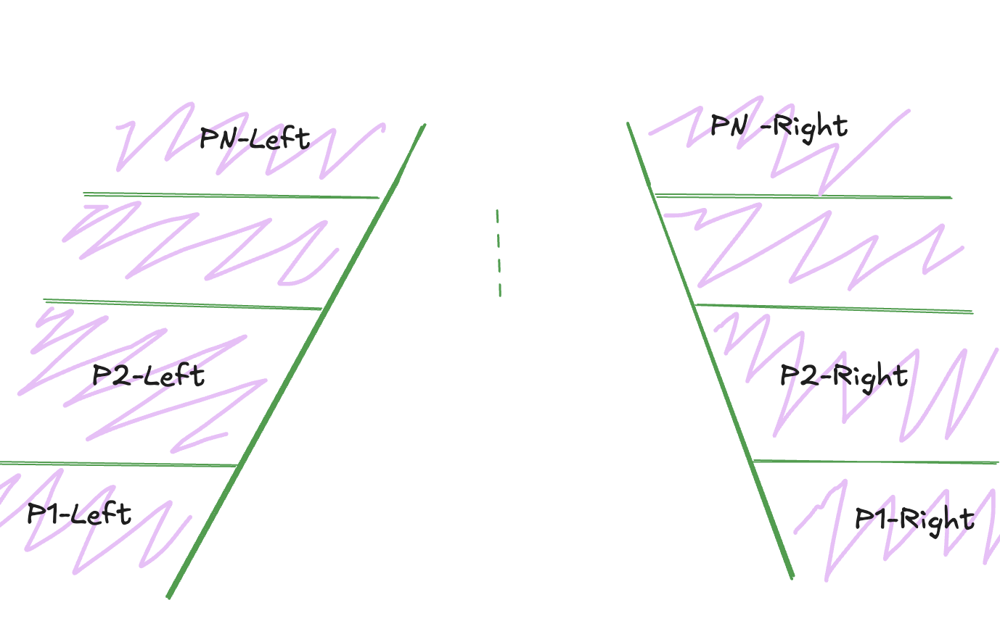

> "Not hearing is not as good as hearing, hearing is not as good as seeing, seeing is not as good as knowing, knowing is not as good as acting; true learning continues until it is put into action."
> - Xunzi

For me action is realized by writing and the goal here is my personal learning. This work is completely derivative. If you want to learn this topic without derivation I would recommend reading [Lou's Pseudo 3D Page](https://www.extentofthejam.com/pseudo/index.html) then [How to build a racing game](https://jakesgordon.com/writing/javascript-racer/). Admittedly I am 14 years behind a fad which was 30 years behind the origin of a technique.

## Setting the foundation

Recently I have been building an understanding of 3D projection in a 2D space. This is an idea that has been around for quite some time and has been used in many games over the years. Most modern games use engines, frameworks, or libraries that hide the intricacies of the solution. I wanted to peak behind the curtain.

The common approaches I have found focus on rasterization and ray tracing techinques. I will be focusing on the rasterization technique as it was the easiest for me to understand.

## Scan lines

For the simplest road we can just use scan line rasterization. Think of the road as having some distance with a focal center point. Then we can draw the road one scan line at a time. This equates to computing the left and right x values for each line of y.

To figure out the correct x value for each y we are going to have to figure out how to draw a three dimensional point in a two dimensional space. If we were to look at the road from the top down then we wouldn't have to move x at all. However in our case we want to look out to a horizon and that requires x to be offset by some z value to create the effect of distance.

The effect of distance can be created by making objects appear further away from the screen by changing their y position. Using the law of similar triangles we can determine by how much to move the position of the object along the y-axis. To do this we need to introduce a camera and use the following equation.

```javascript
const y = cameraHeight * distanceFromCameraToScreen / distanceFromCameraToObject;

// However we want to render line by line going along y so lets compute the distance instead
let distanceFromCameraToObject = cameraHeight * distanceFromCameraToScreen / y;

// oops I lied, one last alteration since we don't want anything above a horizon
distanceFromCameraToObject = (y - horizon) / cameraHeight * distanceFromCameraToScreen;

// Now to project some x from a fixed y we will pull it all together
const x = worldX * distanceFromCameraToScreen / distanceFromCameraToObject
```

In case you are wondering where the law of similar triangles is coming into play, there are two triangles here. The first is a triangle from the camera to the screen and the second is the screen to the object. The second triangle is a projection of the first adding the depth to the object.

```javascript
addEventListener('load', () => {
    let canvas = document.getElementById('canvas');
    let context = canvas.getContext('2d');

    const canvasWidth = canvas.width = window.innerWidth;
    const canvasHeight = canvas.height = window.innerHeight;
    const canvasMiddle = roadMiddle = maxRoadWidth = canvasWidth / 2;
    const horizon = canvasHeight / 2;
    const roadDistance = canvasHeight - horizon;
    const roadGutterWidth = 8;
    const distanceFromCameraToScreen = 1;

    function run() {
        requestAnimationFrame(() => {
            context.clearRect(0, 0, canvasWidth, canvasHeight);

            for (let y = canvasHeight; y > horizon; y--) {
                const z = roadDistance / (y - horizon) * distanceFromCameraToScreen;
                const nextZ = y > horizon + 1 ? roadDistance / (y - 1 - horizon) : Infinity;
                const left = roadMiddle - (maxRoadWidth / z);
                const right = roadMiddle + (maxRoadWidth / z);

                context.beginPath();
                context.moveTo(left, y);
                context.lineTo(left + roadGutterWidth, y);
                context.strokeStyle = 'lightgreen';
                context.stroke();

                context.beginPath();
                context.moveTo(right, y);
                context.lineTo(right + roadGutterWidth, y);
                context.strokeStyle = 'lightgreen';
                context.stroke();
            }

            run();
        });
    }
    run();
});
```

<iframe height="400" width="600" style="border:none" srcdoc="<html> <head> <style> body { margin: 0; display: grid; place-items: center; width: 600px; height: 400px; } button { padding:8px; color:green; background-color:black; margin:auto auto; border:none; } </style> <script> function onClick() { document.querySelector('button').remove(); const ifr = document.createElement('iframe'); ifr.width='600px'; ifr.height='400px'; ifr.style.border='none'; ifr.srcdoc = '<html> <head> <style> body { margin: 0; background-color: black; } </style> <script type=\'text/javascript\'> addEventListener(\'load\', () => { let canvas = document.getElementById(\'canvas\'); let context = canvas.getContext(\'2d\'); const canvasWidth = canvas.width = window.innerWidth; const canvasHeight = canvas.height = window.innerHeight; const canvasMiddle = roadMiddle = maxRoadWidth = canvasWidth / 2; const horizon = canvasHeight / 2; const roadDistance = canvasHeight - horizon; const roadGutterWidth = 8; const distanceFromCameraToScreen = 1; function run() { requestAnimationFrame(() => { context.clearRect(0, 0, canvasWidth, canvasHeight); for (let y = canvasHeight; y > horizon; y--) { const z = roadDistance / (y - horizon) * distanceFromCameraToScreen; const nextZ = y > horizon + 1 ? roadDistance / (y - 1 - horizon) : Infinity; const left = roadMiddle - (maxRoadWidth / z); const right = roadMiddle + (maxRoadWidth / z); context.beginPath(); context.moveTo(left, y); context.lineTo(left + roadGutterWidth, y); context.strokeStyle = \'lightgreen\'; context.stroke(); context.beginPath(); context.moveTo(right, y); context.lineTo(right + roadGutterWidth, y); context.strokeStyle = \'lightgreen\'; context.stroke(); } }); } run(); }); <\/script> </head> <body> <canvas id=\'canvas\'></canvas> </body></html>'; document.body.appendChild(ifr); } </script> </head> <body> <button onclick='onClick()'>Play</button> </body></html>"></iframe>

Notice how we are walking each line of y one pixel at a time. Depending on your history, intuition might prevent you from realizing that you can easily draw ~1000 line segments multiple times a second. Doing this you should be easily be able to hit a frame rate consistent with your monitors refresh rate.


## Sprucing it up a bit

If we imagine we are looking at the road from the perspective of the inside of a car, it would be impossible to tell if we are moving. To see motion on lets add some texture to the road. The easiest way to do this is to draw horizonal lines on either side of the road as visual makers. These effectively create road segments that the camera could progress through.

```javascript
addEventListener('load', () => {
    // Same old stuff
    const segments = Math.round(roadDistance);

    function run() {
        requestAnimationFrame(() => {
                    
            context.clearRect(0, 0, canvasWidth, canvasHeight);

            for (let y = canvasHeight; y > horizon; y--) {
                const z = roadDistance / (y - horizon) * distanceFromCameraToScreen;
                const nextZ = y > horizon + 1 ? roadDistance / (y - 1 - horizon) * distanceFromCameraToScreen : Infinity;
                const roadMiddle = canvasMiddle;
                const left = roadMiddle - (maxRoadWidth / z);
                const right = roadMiddle + (maxRoadWidth / z);
                
                const segmentBoundary = Math.ceil(z);
                const onSegment = segmentBoundary <= segments && segmentBoundary < nextZ;
                
                context.beginPath();
                context.moveTo(!onSegment ? left : 0, y);
                context.lineTo(left, y);
                context.strokeStyle = 'green';
                context.stroke();

                context.beginPath();
                context.moveTo(left, y);
                context.lineTo(left + roadGutterWidth, y);
                context.strokeStyle = 'lightgreen';
                context.stroke();

                context.beginPath();
                context.moveTo(right, y);
                context.lineTo(right + roadGutterWidth, y);
                context.strokeStyle = 'lightgreen';
                context.stroke();

                if (onSegment) {
                    context.beginPath();
                    context.moveTo(right + roadGutterWidth, y);
                    context.lineTo(canvasWidth, y);
                    context.strokeStyle = 'green';
                    context.stroke();
                }
            }

            run();
        });
    }
    run();
});
```

<iframe height="400" width="600" style="border:none" srcdoc="<html> <head> <style> body { margin: 0; display: grid; place-items: center; width: 600px; height: 400px; } button { padding:8px; color:green; background-color:black; margin:auto auto; border:none; } </style> <script> function onClick() { document.querySelector('button').remove(); const ifr = document.createElement('iframe'); ifr.width='600px'; ifr.height='400px'; ifr.style.border='none'; ifr.srcdoc = '<html> <head> <style> body { margin: 0; background-color: black; } </style> <script type=\'text/javascript\'> addEventListener(\'load\', () => { let canvas = document.getElementById(\'canvas\'); let context = canvas.getContext(\'2d\'); const canvasWidth = canvas.width = window.innerWidth; const canvasHeight = canvas.height = window.innerHeight; const canvasMiddle = canvasWidth / 2; const horizon = canvasHeight / 2; const roadDistance = canvasHeight - horizon; const maxRoadWidth = canvasWidth / 2; const segments = Math.round(roadDistance); const roadGutterWidth = 8; const distanceFromCameraToScreen = 1; function run() { requestAnimationFrame(() => { context.clearRect(0, 0, canvasWidth, canvasHeight); for (let y = canvasHeight; y > horizon; y--) { const z = roadDistance / (y - horizon) * distanceFromCameraToScreen; const nextZ = y > horizon + 1 ? roadDistance / (y - 1 - horizon) * distanceFromCameraToScreen : Infinity; const roadMiddle = canvasMiddle; const left = roadMiddle - (maxRoadWidth / z); const right = roadMiddle + (maxRoadWidth / z); const segmentBoundary = Math.ceil(z); const onSegment = segmentBoundary <= segments && segmentBoundary < nextZ; context.beginPath(); context.moveTo(!onSegment ? left : 0, y); context.lineTo(left, y); context.strokeStyle = \'green\'; context.stroke(); context.beginPath(); context.moveTo(left, y); context.lineTo(left + roadGutterWidth, y); context.strokeStyle = \'lightgreen\'; context.stroke(); context.beginPath(); context.moveTo(right, y); context.lineTo(right + roadGutterWidth, y); context.strokeStyle = \'lightgreen\'; context.stroke(); if (onSegment) { context.beginPath(); context.moveTo(right + roadGutterWidth, y); context.lineTo(canvasWidth, y); context.strokeStyle = \'green\'; context.stroke(); } } }); } run(); }); <\/script> </head> <body> <canvas id=\'canvas\'></canvas> </body></html>'; document.body.appendChild(ifr); } </script> </head> <body> <button onclick='onClick()'>Play</button> </body></html>"></iframe>

## Let there be motion

At this point we have a passable road with the illusion of depth but no motion. To get that going we are going to need to start using that camera. As you move the camera across the screen you need to adjust how the segments are drawn. If the camera moved one full segment per frame there would be no noticable movement. Because of this we need to make sure the camera only move a fraction of the distance between z values and adjust our scan lines accordingly.

To make the camera move we just have to adjust the camera position on each render frame. However not all computers have the same processing power and not all monitors have the same refresh rate. So, if we want a consistent experience we need to account for time. There are a few ways of doing this but I have found the easiest way to do this in the browser is with a variable frame rate and a delta time modifier.

```javascript
let distanceFromCameraToScreen = 0;
let lastTime;

function run() {
    requestAnimationFrame((time) => {
        const dt = time - (lastTime ?? time);
        distanceFromCameraToScreen += .0025 * dt; // .0025 is a completely arbirary number because I liked how it looked
        lastTime = time;
        
        // truncated
    });
}
```

Now if we just plug this change into the existing code things might not look as you expect. This will cause the view to appear to zoom out and give the impression of lifting off of the road. Eventually the segments will start to compress to nothing as well since our segements are bounded at the road distance. So lets tackle this one problem at a time. First Let's stop moving up and start moving forward. To do this we are going to change our equations just a bit.

```javascript
let distanceFromCameraToScreen = 0;
let lastTime;

function run() {
    requestAnimationFrame((time) => {
        const dt = time - (lastTime ?? time);
        distanceFromCameraToScreen += .05 * dt; // speeding things up because you could be fooled into thinking this is fine
        lastTime = time;
        
        // truncated
        for (let y = canvasHeight; y > horizon; y--) {
            const z = roadDistance / (y - horizon);
            const nextZ = y > horizon + 1 ? roadDistance / (y - 1 - horizon) : Infinity;
            const roadMiddle = canvasMiddle;
            const left = roadMiddle - (maxRoadWidth / z);
            const right = roadMiddle + (maxRoadWidth / z);
            
            const segmentBoundary = Math.ceil(z + distanceFromCameraToScreen);
            const onSegment = segmentBoundary <= segments && segmentBoundary < nextZ + distanceFromCameraToScreen;
            
            // truncated draw logic
        }
    });
}
```

Now if you watched this animation for long enough you would notice that eventually the segments start disappearing until we are left with what looks like our first road. This is happening again because we have bounded segments. To deal with this we could grow our segments over time but instead we are going to play a little trick with the camera. Instead of moving over all segments we are just going to adjust our position within the first lines by using some modulo math.

```javascript
function run() {
    requestAnimationFrame((time) => {
        let dt = time - (lastTime ?? time);
        lastTime = time;

        distanceFromCameraToScreen += (dt * .0025);
        const cameraOffset = distanceFromCameraToScreen % 1; // Only move a fraction of a z at any given time
        // truncated

        for (let y = canvasHeight; y > horizon; y--) {
            const z = roadDistance / (y - horizon);
            const nextZ = y > horizon + 1 ? roadDistance / (y - 1 - horizon) : Infinity;
            const roadMiddle = canvasMiddle;
            const left = roadMiddle - (maxRoadWidth / z);
            const right = roadMiddle + (maxRoadWidth / z);
            
            const segmentBoundary = Math.ceil(z + cameraOffset);
            const onSegment = segmentBoundary <= segments && segmentBoundary < nextZ + cameraOffset;
            
            // truncated
        }
    });
}
```

Put all of this together and we get this effect.

<iframe height="400" width="600" style="border:none" srcdoc="<html> <head> <style> body { margin: 0; display: grid; place-items: center; width: 600px; height: 400px; } button { padding:8px; color:green; background-color:black; margin:auto auto; border:none; } </style> <script> function onClick() { document.querySelector('button').remove(); const ifr = document.createElement('iframe'); ifr.width='600px'; ifr.height='400px'; ifr.style.border='none'; ifr.srcdoc = '<html> <head> <style> body { margin: 0; background-color: black; } </style> <script type=\'text/javascript\'> addEventListener(\'load\', () => { let canvas = document.getElementById(\'canvas\'); let context = canvas.getContext(\'2d\'); const canvasWidth = canvas.width = window.innerWidth; const canvasHeight = canvas.height = window.innerHeight; const canvasMiddle = canvasWidth / 2; const horizon = canvasHeight / 2; const roadDistance = canvasHeight - horizon; const maxRoadWidth = canvasWidth / 2; const segments = Math.round(roadDistance); const roadGutterWidth = 8; let distanceFromCameraToScreen = 0; let lastTime; function run() { requestAnimationFrame((time) => { let dt = time - (lastTime ?? time); lastTime = time; context.clearRect(0, 0, canvasWidth, canvasHeight); distanceFromCameraToScreen += (dt * .0025); const cameraOffset = distanceFromCameraToScreen % 1; for (let y = canvasHeight; y > horizon; y--) { const z = roadDistance / (y - horizon); const nextZ = y > horizon + 1 ? roadDistance / (y - 1 - horizon) : Infinity; const roadMiddle = canvasMiddle; const left = roadMiddle - (maxRoadWidth / z); const right = roadMiddle + (maxRoadWidth / z); const segmentBoundary = Math.ceil(z + cameraOffset); const onSegment = segmentBoundary <= segments && segmentBoundary < nextZ + cameraOffset; context.beginPath(); context.moveTo(!onSegment ? left : 0, y); context.lineTo(left, y); context.strokeStyle = \'green\'; context.stroke(); context.beginPath(); context.moveTo(left, y); context.lineTo(left + roadGutterWidth, y); context.strokeStyle = \'lightgreen\'; context.stroke(); context.beginPath(); context.moveTo(right, y); context.lineTo(right + roadGutterWidth, y); context.strokeStyle = \'lightgreen\'; context.stroke(); if (onSegment) { context.beginPath(); context.moveTo(right + roadGutterWidth, y); context.lineTo(canvasWidth, y); context.strokeStyle = \'green\'; context.stroke(); } } run(); }); } run(); }); <\/script> </head> <body> <canvas id=\'canvas\'></canvas> </body></html>'; document.body.appendChild(ifr); } </script> </head> <body> <button onclick='onClick()'>Play</button> </body></html>"></iframe>

## Getting curvy

Now that we have motion wouldn't it be neat if we could make the road move left and right creating the effect of driving through a turn? Let's take a moment and observe something about how we are rendering each left and right position.

```javascript
const left = roadMiddle - (maxRoadWidth / z);
const right = roadMiddle + (maxRoadWidth / z);
```

Notice how we are positioning the left and right as relative positions of the middle of the road? What if the middle of the road didn't happen to be the middle of the screen but another position? If we moved this value lower the scan line would appear to shift left and higher right.

To make this appear correct we will have to integrate the position over each scan line to create a natural looking curve.

```javascript
const curveAmount = .005;

let roadMiddle = canvasMiddle;
let deltaX = 0;
for (let y = canvasHeight; y > horizon; y--) {
    deltaX += curveAmount;
    roadMiddle += deltaX;
}
```

Using this we should get the effect of a road that curves to the left. If your intuition was that the road would curve right remember we are drawing back to front not front to back. If we used a `-.005` it would be curving to the right.

This is neat but now the motion code results in moving along a curve forever. To address this in our simple test we can slowely decrease the `curveAmount` over time until we hit zero.

Adding something trivial like this to the code would do the trick

```javascript
if (curveAmount != 0) {
    curveAmount += .0000002 * dt;
}
if (curveAmount > 0) {
    curveAmount = 0;
}

let roadMiddle = canvasMiddle;
let deltaX = 0;
for (let y = canvasHeight; y > horizon; y--) {
    deltaX += curveAmount;
    roadMiddle += deltaX;
}
```

Bring it all together and we get this.

<iframe height="400" width="600" style="border:none" srcdoc="<html> <head> <style> body { margin: 0; display: grid; place-items: center; width: 600px; height: 400px; } button { padding:8px; color:green; background-color:black; margin:auto auto; border:none; } </style> <script> function onClick() { document.querySelector('button').remove(); const ifr = document.createElement('iframe'); ifr.width='600px'; ifr.height='400px'; ifr.style.border='none'; ifr.srcdoc = '<html> <head> <style> body { margin: 0; background-color: black; } </style> <script type=\'text/javascript\'> addEventListener(\'load\', () => { let canvas = document.getElementById(\'canvas\'); let context = canvas.getContext(\'2d\'); const canvasWidth = canvas.width = window.innerWidth; const canvasHeight = canvas.height = window.innerHeight; const canvasMiddle = canvasWidth / 2; const horizon = canvasHeight / 2; const roadDistance = canvasHeight - horizon; const maxRoadWidth = canvasWidth / 2; const segments = Math.round(roadDistance); const roadGutterWidth = 8; let distanceFromCameraToScreen = 0; let lastTime; let curveAmount = -.004; function run() { requestAnimationFrame((time) => { let dt = time - (lastTime ?? time); lastTime = time; context.clearRect(0, 0, canvasWidth, canvasHeight); distanceFromCameraToScreen += (dt * .0025); if (curveAmount != 0) { curveAmount += .0000002 * dt; } if (curveAmount > 0) { curveAmount = 0; } const cameraOffset = distanceFromCameraToScreen % 1; let roadMiddle = canvasMiddle; let dx = 0; for (let y = canvasHeight; y > horizon; y--) { const z = roadDistance / (y - horizon); const nextZ = y > horizon + 1 ? roadDistance / (y - 1 - horizon) : Infinity; dx += curveAmount; roadMiddle += dx; const left = roadMiddle - (maxRoadWidth / z); const right = roadMiddle + (maxRoadWidth / z); const segmentBoundary = Math.ceil(z + cameraOffset); const onSegment = segmentBoundary <= segments && segmentBoundary < nextZ + cameraOffset; context.beginPath(); context.moveTo(!onSegment ? left : 0, y); context.lineTo(left, y); context.strokeStyle = \'green\'; context.stroke(); context.beginPath(); context.moveTo(left, y); context.lineTo(left + roadGutterWidth, y); context.strokeStyle = \'lightgreen\'; context.stroke(); context.beginPath(); context.moveTo(right, y); context.lineTo(right + roadGutterWidth, y); context.strokeStyle = \'lightgreen\'; context.stroke(); if (onSegment) { context.beginPath(); context.moveTo(right + roadGutterWidth, y); context.lineTo(canvasWidth, y); context.strokeStyle = \'green\'; context.stroke(); } } run(); }); } run(); }); <\/script> </head> <body> <canvas id=\'canvas\'></canvas> </body></html>'; document.body.appendChild(ifr); } </script> </head> <body> <button onclick='onClick()'>Play</button> </body></html>"></iframe>

## Changing render strategy

Up until this point we have been rendering a road using scan lines. This has worked out well for us, but once we get to hills it becomes easier to start working with polygons. To add hills and keep the math sane it is easier to walk one segment at a time. Now we could see each of these segments as a polygon. However because of our rendering strategy we will instead draw it as individual lines resulting two shapes that resemable a polygon while not being one.



To make this work we are first going to have to stop iterating over every position of y and instead start iterating over each segment. This is a fairly trival change on the for loop.

```diff
- for (let y = canvasHeight; y > horizon; y--) {
+ for (let segment = segments; segment > 0; segment--) {
```

Now we have to change up the projection math a bit. Instead of just finding a left and a right for each y we now need to find a top y, top left x, top right x, bottom y, bottom left x, and bottom right x. Putthing that all together we get something like this.

```javascript
const topZ = segment + 1 - cameraOffset;
const bottomZ = segment - cameraOffset;

const topY = horizon + (roadDistance + distanceFromCameraToScreen) / topZ;
const bottomY = horizon + (roadDistance + distanceFromCameraToScreen) / bottomZ;
    
const topLeft = roadMiddle - (maxRoadWidth / topZ);
const topRight = roadMiddle + (maxRoadWidth / topZ);
    
const bottomLeft = roadMiddle - (maxRoadWidth / bottomZ);
const bottomRight = roadMiddle + (maxRoadWidth / bottomZ);

const topGutterWidth = roadGutterWidth / topZ;
const bottomGutterWidth = roadGutterWidth / bottomZ;
```

Finally we need to draw those individual segment pieces which will update our line drawing code to be a bit more verbose.

```javascript
context.beginPath();
context.moveTo(0, topY);
context.lineTo(topLeft - topGutterWidth, topY);
context.strokeStyle = 'green';
context.stroke();

context.beginPath();
context.moveTo(topLeft - topGutterWidth, topY);
context.lineTo(topLeft, topY);
context.lineTo(bottomLeft, bottomY);
context.lineTo(bottomLeft - bottomGutterWidth, bottomY);
context.closePath();
context.fillStyle = 'lightgreen';
context.fill();

context.beginPath();
context.moveTo(bottomLeft - (roadGutterWidth / 2), bottomY);
context.lineTo(0, bottomY);
context.strokeStyle = 'green';
context.stroke();

// right side
context.beginPath();
context.moveTo(canvasWidth, topY);
context.lineTo(topRight + (roadGutterWidth / 2), topY);
context.strokeStyle = 'green';
context.stroke();

context.beginPath();
context.moveTo(topRight - topGutterWidth, topY);
context.lineTo(topRight, topY);
context.lineTo(bottomRight, bottomY);
context.lineTo(bottomRight - bottomGutterWidth, bottomY);
context.closePath();
context.fillStyle = 'lightgreen';
context.fill();

context.beginPath();
context.moveTo(bottomRight + (roadGutterWidth / 2), bottomY);
context.lineTo(canvasWidth, bottomY);
context.strokeStyle = 'green';
context.stroke();
```

Now I could have added some functions and made this a bit easier to understand but I want to show the end result with as little overhead as possible to show the exact code required to make this work without any abstraction.

For those that are eagle-eyed observers you will notice that this logic fixes a bug we had up until this point. Up until this point we had the gutter be a constant 8px regradless of projection. As I was revisiting this and breaking down the problem into steps I found something I had missed in prior attempts at this.

With all of this we can put this together and get something familiar that we have already seen, a moving road.

<iframe height="400" width="600" style="border:none" srcdoc="<html> <head> <style> body { margin: 0; display: grid; place-items: center; width: 600px; height: 400px; } button { padding:8px; color:green; background-color:black; margin:auto auto; border:none; } </style> <script> function onClick() { document.querySelector('button').remove(); const ifr = document.createElement('iframe'); ifr.width='600px'; ifr.height='400px'; ifr.style.border='none'; ifr.srcdoc = '<html> <head> <style> body { margin: 0; background-color: black; } </style> <script type=\'text/javascript\'> addEventListener(\'load\', () => { let canvas = document.getElementById(\'canvas\'); let context = canvas.getContext(\'2d\'); const canvasWidth = canvas.width = window.innerWidth; const canvasHeight = canvas.height = window.innerHeight; const canvasMiddle = canvasWidth / 2; const horizon = canvasHeight / 2; const roadDistance = canvasHeight - horizon; const maxRoadWidth = canvasWidth / 2; const segments = Math.round(roadDistance); const roadGutterWidth = 8; let distanceFromCameraToScreen = 0; let lastTime; function run() { requestAnimationFrame((time) => { let dt = time - (lastTime ?? time); lastTime = time; context.clearRect(0, 0, canvasWidth, canvasHeight); distanceFromCameraToScreen += (dt * .0025); const cameraOffset = distanceFromCameraToScreen % 1; let roadMiddle = canvasMiddle; for (let segment = segments; segment > 0; segment--) { const topZ = segment + 1 - cameraOffset; const bottomZ = segment - cameraOffset; const topY = horizon + (roadDistance + cameraOffset) / topZ; const bottomY = horizon + (roadDistance + cameraOffset) / bottomZ; const topLeft = roadMiddle - (maxRoadWidth / topZ); const topRight = roadMiddle + (maxRoadWidth / topZ); const bottomLeft = roadMiddle - (maxRoadWidth / bottomZ); const bottomRight = roadMiddle + (maxRoadWidth / bottomZ); const topGutterWidth = roadGutterWidth / topZ; const bottomGutterWidth = roadGutterWidth / bottomZ; context.beginPath(); context.moveTo(0, topY); context.lineTo(topLeft - topGutterWidth, topY); context.strokeStyle = \'green\'; context.stroke(); context.beginPath(); context.moveTo(topLeft - topGutterWidth, topY); context.lineTo(topLeft, topY); context.lineTo(bottomLeft, bottomY); context.lineTo(bottomLeft - bottomGutterWidth, bottomY); context.closePath(); context.fillStyle = \'lightgreen\'; context.fill(); context.beginPath(); context.moveTo(bottomLeft - (roadGutterWidth / 2), bottomY); context.lineTo(0, bottomY); context.strokeStyle = \'green\'; context.stroke(); context.beginPath(); context.moveTo(canvasWidth, topY); context.lineTo(topRight + (roadGutterWidth / 2), topY); context.strokeStyle = \'green\'; context.stroke(); context.beginPath(); context.moveTo(topRight - topGutterWidth, topY); context.lineTo(topRight, topY); context.lineTo(bottomRight, bottomY); context.lineTo(bottomRight - bottomGutterWidth, bottomY); context.closePath(); context.fillStyle = \'lightgreen\'; context.fill(); context.beginPath(); context.moveTo(bottomRight + (roadGutterWidth / 2), bottomY); context.lineTo(canvasWidth, bottomY); context.strokeStyle = \'green\'; context.stroke(); } run(); }); } run(); }); <\/script> </head> <body> <canvas id=\'canvas\'></canvas> </body></html>'; document.body.appendChild(ifr); } </script> </head> <body> <button onclick='onClick()'>Play</button> </body></html>"></iframe>

## Adding those hills

Now that we have changed our rendering strategy we can get around to adding in those hills.